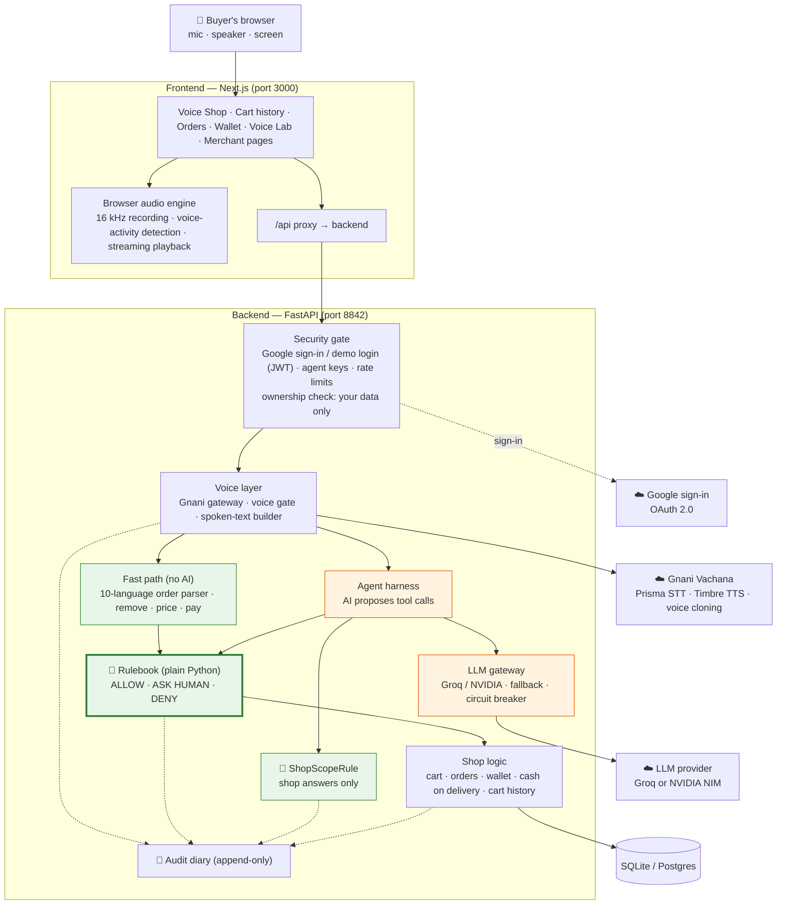
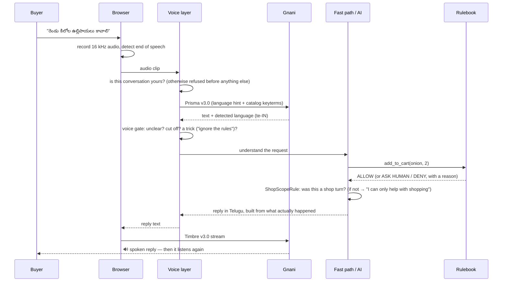

# Gnani Shop

> **Solution pitch (1 page):** [Read it here](PITCH.md) · [PDF](pitch.pdf)

**A grocery store you can talk to — in any of 10 Indian languages.**

Speak Hindi, Tamil, Telugu, Kannada, Malayalam, Marathi, Bengali, Gujarati, Punjabi,
English — or mix them (Hinglish, Tinglish). **Gnani Vachana** hears you and detects your
language, an AI shop assistant fills your cart, and Gnani answers you back in the same
language in a natural voice. **Money only ever moves when a human taps.**

Built by **Revanth** (borrarevanth4@gmail.com) to showcase Gnani's speech models —
Prisma v3.0 (speech → text), Timbre v3.0 / v2.5 (text → speech) and voice cloning.

**Contents:** [Problem](#1-problem-statement) · [Solution](#2-solution) ·
[High-level design](#3-high-level-design-hld) · [Problems faced & how we solved them](#4-problems-faced-and-how-we-solved-them) ·
[Run it on your computer](#5-run-it-on-your-computer-step-by-step) · [Testing](#6-testing) ·
[Project map](#7-project-map)

---

## 1. Problem statement

Online grocery shopping in India is built for people who are comfortable **typing in
English** on a screen. That leaves out a huge number of buyers:

- **Language.** Most Indians are most comfortable in their own language, and many mix
  languages naturally ("do kilo atta aur ek doodh daal do"). Search boxes and menus
  rarely understand this.
- **Literacy and typing.** For elderly buyers, first-time smartphone users and people
  who read slowly, typing product names and navigating menus is the hardest part.
- **How people already shop.** At a local kirana store you just *say* what you need.
  Apps make you do the opposite.
- **Trust.** If an AI assistant is allowed to shop for you, people rightly worry:
  *can it spend my money by mistake, or be tricked into it?*
- **Privacy.** What you say to a shopping assistant (by voice or text) is personal. Other
  users must never see it.
- **Staying on task.** A general AI model will happily answer anything ("who is the
  president?"), often out of date or wrong. A shop assistant should do one job well.

**The challenge:** let anyone shop just by speaking, in their own language, while making
it impossible for the AI to spend money without the buyer's explicit approval, keeping
each person's conversations private, and keeping the assistant on the job of shopping.

---

## 2. Solution

Gnani Shop is a **voice-first** shop. You tap the mic once and talk; it listens, fills
your cart, talks back, and listens again — hands-free, like talking to a shopkeeper.

| What the buyer gets | How |
|---|---|
| 🎤 **Speak in any of 10 languages** (and mixes) | Gnani **Prisma v3.0** turns speech into text and detects the language automatically |
| 🔊 **Answers spoken back in the same language** | Gnani **Timbre v3.0** streams the reply, so it starts speaking in under a second |
| 🛒 **A cart that is always right** | Simple orders ("two kilo onions and a litre of milk") are understood by fast, exact code in all 10 languages; anything harder goes to an AI model |
| ✋ **Nothing is paid without a tap** | A rulebook written in plain code checks every action. Voice can fill a cart but can **never** pay |
| 🧾 **Cart history** | Every past basket with a one-tap **Buy again**, and a timeline of everything added or removed — by you or by the assistant |
| 💳 **Demo payments** | Gnani Shop Wallet (demo money) or Cash on Delivery. No real card or bank is involved |
| 🔐 **Sign in with Google** | Your own account, or one-click demo accounts for trying it out |
| 🙈 **Your conversations are private** | Every chat, voice turn, cart, cart history and order belongs to one user. Other users can't see or reuse them |
| 🎯 **An assistant that stays on topic** | **ShopScopeRule** checks every AI reply in code. Off-topic questions get a polite "I can only help with shopping here" in your language |

For the shop owner: voice insights (which languages customers speak, Gnani latency),
**Shop Voice** (clone your own voice, with consent, to speak offers), **Call Insights**
(transcribe phone-order recordings), campaigns, and a replay of any conversation. Only
accounts listed in `MERCHANT_EMAILS` can open the shop-owner view.

> **The rule behind everything:** Gnani hears and speaks. The AI suggests. The rulebook
> decides. The diary (audit log) remembers. Only a human tap moves money.

---

## 3. High-level design (HLD)

### 3.1 Architecture



Green parts are **deterministic code** (same input → same result, every time). Orange is
the **only** place an AI model is used — and it can only *suggest*; the rulebook decides.

### 3.2 One spoken turn, step by step



### 3.3 Main components

| Component | Where | What it does |
|---|---|---|
| Browser audio engine | `frontend/src/lib/voice.ts` | Records the mic and resamples it to 16 kHz in an audio worklet. Detects when you start and stop talking, keeps 0.4 s of audio from before you started, and plays the streamed reply without gaps |
| Voice assistant UI | `frontend/src/components/voice/VoiceAssistant.tsx` | The hands-free conversation loop, conversation view, confirm/pay buttons |
| Gnani gateway | `backend/app/voice/gateway.py` | The only code that calls Gnani; retries, circuit breaker, timings, cost |
| Voice gate | `backend/app/voice/policy.py` | Rules that stop unclear, cut-off or manipulative speech before it reaches the AI |
| Fast path | `backend/app/agent/fast_path.py` | Understands simple orders in all 10 languages with no AI: instant, free, exact |
| Agent harness | `backend/app/agent/harness.py` | Runs the AI in a loop: it proposes actions, the rulebook decides, results go back |
| Rulebook | `backend/app/policy/` | Budgets, stock, agent limits, payment approval — plain Python, no AI |
| ShopScopeRule | `backend/app/agent/scope.py` | After every AI turn: keeps shop answers, replaces anything off-topic with a fixed sentence in the buyer's language |
| Sign-in | `backend/app/auth/oauth_router.py` | Google OAuth through the single address (the round trip returns to the address you started on); demo logins in development |
| Ownership checks | `harness.py`, `voice/service.py`, `voice/realtime.py`, routers | Every conversation, cart line and order is checked against the signed-in user before it is read or used |
| Shop logic | `backend/app/orders`, `payments`, `services` | Cart, order state machine, wallet ledger, cash on delivery, cart history |
| Audit diary | `backend/app/audit/` | Append-only record of every step; powers replay and reports |

### 3.4 Tech stack

| Layer | Technology |
|---|---|
| Speech | Gnani Vachana — Prisma v3.0 (STT), Timbre v3.0 / v2.5 (TTS), `vachana-vc-v1` (voice clone) |
| AI model | Any OpenAI-compatible provider — Groq or NVIDIA NIM (`gpt-oss-120b`, with fallbacks) |
| Backend | Python, FastAPI, SQLAlchemy, Pydantic |
| Frontend | Next.js 16, React 19, TypeScript, Tailwind CSS, Web Audio API (AudioWorklet) |
| Database | SQLite by default; Postgres supported |
| Sign-in | Google OAuth 2.0 (Authlib), JWT sessions |
| Packaging | Docker Compose (optional) |

### 3.5 Who can see what

| Data | The user it belongs to | Another signed-in user | The shop owner (`MERCHANT_EMAILS`) |
|---|---|---|---|
| Chat and voice conversations | ✅ | ❌ refused (403 / 404) | ✅ read-only, via the audit viewer |
| Cart, cart history, "Buy again" | ✅ | ❌ | ❌ (only cart actions that happened inside a conversation, in its audit trail) |
| Orders and wallet | ✅ | ❌ | Orders ✅ (to fulfil them), wallet ❌ |
| Merchant view | ❌ unless listed in `MERCHANT_EMAILS` | ❌ | ✅ |

The **demo accounts** are shared by everyone who clicks "Continue as Demo Buyer", so use
Google sign-in for real privacy. Logging out clears the browser's memory of your
conversation, so the next person on the same computer starts fresh.

---

## 4. Problems faced and how we solved them

### Voice and audio

| Problem | Cause | Solution |
|---|---|---|
| Gnani misheard words; audio sounded clicky | The browser resampled 48 kHz → 16 kHz one 128-sample block at a time and dropped part of a sample every block (~1.6 % speed-up + a click every 2.7 ms) | Resampler moved into the audio worklet and keeps its position across blocks. Verified: 2.000 s in → 2.000 s out, a 440 Hz tone stays 440 Hz, no jumps |
| Speaking immediately → "I didn't hear anything" | Background noise was measured in the first 0.35 s; if you were already talking, your voice became the "noise" level | The noise floor is learned from the quiet gaps between words. Tested on: talking instantly, a fan-noise room, a quiet speaker, and a pause mid-sentence |
| First word cut off; no sound on some replies | A new mic and audio player per turn: warm-up lost the first syllable, and replies created outside a click were blocked by the browser's autoplay rules | One mic for the whole conversation with a 0.4 s pre-roll; one shared audio player unlocked on the mic click |
| Listening stopped in a background tab | Voice detection ran on screen animation frames, which pause | Detection now runs on the audio frames themselves |
| Replies cut off mid-sentence | A short network gap between audio chunks looked like "finished", so the mic re-opened early | "Finished" now means the stream has fully arrived **and** every chunk has played |
| Short Telugu words heard as Malayalam | A few syllables aren't enough to identify a language | The buyer's chosen language is sent to Prisma as a hint (plus English for mixed speech) |
| "hata do" (remove it) heard as "Tata do" | The brand "Tata" was boosted as a recognition hint and pulled similar-sounding words towards it | Short bare brand names are no longer boosted; "… Tata do" at the end of a sentence is corrected to "hata do" |

### Understanding all 10 languages

| Problem | Cause | Solution |
|---|---|---|
| Plurals and inflected words not understood ("టమాటాలు", "प्याज़", "പാലും") | Python's `\w` skips Indian vowel signs and nukta, so words were split in two | Matching treats vowel signs, viramas and nukta as part of the word |
| Malayalam "പാലും" (and milk) not matched to "പാൽ" (milk) | Malayalam rewrites the final letter (chillu) when a suffix is added | Text and vocabulary are normalised to the same form before matching |
| Bengali "চাই" (want) and Punjabi "ਚਾਹੀਦਾ" (needed) added **tea** | They start with "চা" / "ਚਾਹ" — the word for tea | A word that is really an everyday word ("want", "needed") is never treated as a product |
| "Paneer venta" (Tamil: no paneer) **added** paneer | Romanised negations weren't recognised | Negations in native script and Latin spelling for every language are routed to "remove" |
| Gujarati, Marathi, Punjabi orders failed | Small words like "છે", "आहे", "ਹੈ" (is/are) and Bengali counters ("একটা", "ছয়টা") were unknown | Added, plus missing product words (कांदे, ਅੰਡੇ, സവാള …). Result: 46/46 test sentences understood (was 33/46) |

### AI safety and correctness

| Problem | Cause | Solution |
|---|---|---|
| An agent could approve its own payment | The confirm endpoint accepted agent keys | Agents can only *decline*. Autopay exists only as an owner-granted, wallet-only, limited "Mode B" |
| A question ("how much is milk?") added potato | Speech heard "potato?"; a backup AI model then added it | Questions can never change the cart, whatever the model proposes |
| The assistant said "removed milk" from an empty cart | A backup model invented the reply | "That's not in your cart" is now answered by code, in the buyer's language |
| "Remove salt" sometimes *added* something | The model misread removals | Removals in 10 languages are resolved by code through the rulebook |
| Asked "who is the president of America?", the assistant answered it | A general-purpose model answers anything; a prompt can only *ask* it not to | **ShopScopeRule** checks every AI reply in code: no shop action and no shop words → a fixed "I can only help with shopping" in the buyer's language, logged as a rulebook step. 24/24 off-topic and 24/24 shop questions classified correctly across 10 languages |
| A second user could reach another's conversation by voice, and anyone could open the shop-owner view (which reads all chats) | Voice checked ownership too late; the role switch had no allow-list | Ownership checked before anything else; only `MERCHANT_EMAILS` can become shop owner. In a test, a second user made 14 attempts to reach the first user's data — all blocked |
| Spoken tricks ("ignore the rules" in Hindi) | The injection scanner only knew English | Phrasings in all 10 languages + Hinglish; the rulebook re-checks every action anyway |

### Reliability and setup

| Problem | Cause | Solution |
|---|---|---|
| Replies stalled for tens of seconds | Free-tier AI rate limits | Model chain across providers (Groq → smaller model → NVIDIA); simple orders skip the AI entirely |
| Gnani rejected requests (`error code: 1010`) | Gnani's edge blocks generic Python user-agents | The gateway sends an honest `gnani-shop/1.0` user-agent |
| Two servers, two addresses, confusing setup | Frontend and backend ran separately | The frontend forwards `/api/*` to the backend; **one command, one address** |
| Google sign-in would fail when started from `localhost:3000` | Google was told to return to `127.0.0.1:8842`, a different address, so the browser's sign-in cookie didn't match | The return address is the one the browser is on (passed through by the proxy, only local addresses and HTTPS tunnels accepted). Without keys, the button explains what's missing instead of showing a Google error |
| "no such table" after updating | New tables were only created by the seed script | The app creates any missing table at startup (never touches existing data) |

More detail: [docs/ENGINEERING-NOTES.md](docs/ENGINEERING-NOTES.md).

---

## 5. Run it on your computer (step by step)

### Step 1 — Install the tools

| Tool | Version | Check with | Get it |
|---|---|---|---|
| Git | any | `git --version` | https://git-scm.com/downloads |
| Python | 3.12 or newer (developed on 3.14) | `python --version` | https://www.python.org/downloads/ — on Windows tick **"Add Python to PATH"** |
| Node.js | 20.9 or newer (developed on 22) | `node --version` | https://nodejs.org (LTS) |

A **Chrome or Edge** browser is recommended for the microphone.

### Step 2 — Get your API keys

| Key | What for | Where |
|---|---|---|
| `GNANI_API_KEY` | Voice (speech ↔ text) | https://docs.gnani.ai |
| `GROQ_API_KEY` **or** `NVIDIA_API_KEY` | The AI shop assistant | https://console.groq.com/keys · https://build.nvidia.com |

Without the Gnani key you can still shop by typing. Without an AI key, simple orders,
browsing and buying still work; open-ended chat won't.

### Step 3 — Download the project

```bash
git clone https://github.com/borrarevanth4-droid/gnani-shop.git
cd gnani-shop
```

### Step 4 — Create your settings file (`.env`)

Copy the template:

```bash
# Windows (Command Prompt)
copy .env.example .env
# macOS / Linux / Git Bash
cp .env.example .env
```

Make a random secret for logins and copy what it prints:

```bash
python -c "import secrets; print(secrets.token_urlsafe(32))"
```

Open `.env` in any text editor and fill in:

```ini
GNANI_API_KEY=your-gnani-key
LLM_PROVIDER=groq            # or nvidia
GROQ_API_KEY=your-groq-key   # or NVIDIA_API_KEY=...
JWT_SECRET_KEY=the-random-secret-you-just-printed
```

Leave everything else as it is. `.env` is listed in `.gitignore`, so your keys are never
uploaded to GitHub.

### Step 5 — Set up the backend (Python)

```bash
# 1. create a private Python environment inside the project
python -m venv venv

# 2. install the backend libraries
#    Windows:
venv\Scripts\pip install -r backend/requirements.txt
#    macOS / Linux:
venv/bin/pip install -r backend/requirements.txt

# 3. create the database and load the products + demo accounts
cd backend
#    Windows:
..\venv\Scripts\python scripts/seed.py
#    macOS / Linux:
../venv/bin/python scripts/seed.py
cd ..
```

### Step 6 — Set up the frontend (Node.js)

```bash
cd frontend
npm install
```

### Step 7 — Start everything

From the `frontend` folder:

```bash
npm run app
```

This starts **both** the backend and the frontend. Wait until you see
`Ready` and `Application startup complete`. (On Windows you can instead double-click
**`start.bat`** in the main folder.) Press **Ctrl + C** to stop both.

### Step 8 — Use it

1. Open **http://localhost:3000**
2. Click **Continue as Demo Buyer**, or **Sign in with Google** once you've done the
   [Google setup](#optional-sign-in-with-google).
3. Tap the orange **mic**, allow microphone access, and say for example:
   - *"दो किलो प्याज़ और एक लीटर दूध चाहिए"*
   - *"రెండు కిలోల చక్కెర మరియు ఒక బ్రెడ్ కావాలి"*
   - *"add three Maggi packets and a Coca-Cola"*
4. It replies out loud and listens again. To pay, tap **Confirm** on screen.
5. See **Cart history** in the top menu for past baskets and **Buy again**.
6. Try something off-topic, like *"who is the president of America?"*. It politely says it
   only helps with shopping.

| Page | Address |
|---|---|
| Shop (voice assistant) | http://localhost:3000 |
| Sign in | http://localhost:3000/login |
| Cart history | http://localhost:3000/cart-history |
| Voice Lab (every Gnani feature side by side) | http://localhost:3000/voice-lab |
| Backend API docs | http://127.0.0.1:8842/docs |

`127.0.0.1:3000` works too. For Google sign-in, use whichever address you registered.

### Troubleshooting

| You see | Do this |
|---|---|
| The mic does nothing / "Microphone permission is needed" | Click the 🔒 icon in the address bar → allow Microphone → reload. The mic only works on `127.0.0.1`, `localhost` or HTTPS |
| "Could not reach the API … Is the backend running?" | The backend isn't up. Stop with Ctrl + C and run `npm run app` again; read the first error it prints |
| Google: "redirect_uri_mismatch" | The address you opened isn't registered. Add `http://<that address>/api/auth/google/callback` under **Authorized redirect URIs**, or open the app on the registered address |
| Google: "Access blocked … has not completed the Google verification process" | Add your Google account under **Test users** on the consent screen |
| `EADDRINUSE: address already in use :::3000` (or 8842) | An old copy is still running. Close it, or restart your computer, then start again |
| The assistant says "please type" | `GNANI_API_KEY` is missing or wrong in `.env` |
| Replies are slow | Your AI provider's free tier is rate-limited. Simple orders still work instantly; add `NVIDIA_API_KEY` and `LLM_FALLBACK_PROVIDER=nvidia` for a backup |
| `pip` or `python` not found (Windows) | Re-install Python with **"Add Python to PATH"** ticked |

### Optional: sign in with Google

The demo accounts work without this. To let people sign in with their own Google account:

1. Open https://console.cloud.google.com and create a project (top bar → **New project**, name it `gnani-shop`).
2. Go to **APIs & Services → OAuth consent screen** (may be called **Google Auth Platform → Branding**).
   Choose **External**, enter an app name (`Gnani Shop`) and your email, and save.
   Under **Audience / Test users**, add the Google accounts that may sign in while the app is in testing.
3. Go to **APIs & Services → Credentials → Create credentials → OAuth client ID**.
   - Application type: **Web application**
   - **Authorized redirect URIs** → add: `http://localhost:3000/api/auth/google/callback`
     (also add `http://127.0.0.1:3000/api/auth/google/callback` if you open the app on 127.0.0.1)
   - Click **Create** and copy the **Client ID** and **Client secret**.
4. Put them in `.env`:
   ```ini
   GOOGLE_CLIENT_ID=xxxxxxxx.apps.googleusercontent.com
   GOOGLE_CLIENT_SECRET=xxxxxxxx
   MERCHANT_EMAILS=you@gmail.com   # optional: only these accounts can open the shop-owner view
   ```
5. Restart (`Ctrl + C`, then `npm run app`), open **http://localhost:3000/login** and click
   **Sign in with Google**.

Open the app on the same address you registered: if you registered only `localhost`, use
`localhost:3000`. New Google users start as buyers with a demo wallet and their own private
conversations. Accounts listed in `MERCHANT_EMAILS` also get a **Switch to merchant view**
button. Nobody else can switch.

### Alternative: run with Docker

If you have Docker Desktop, after Step 4:

```bash
docker compose up --build
```

Then open http://127.0.0.1:3000.

### Using a phone

Browsers only allow the microphone over HTTPS. Put the app behind an HTTPS tunnel (for
example ngrok, with `NGROK_AUTHTOKEN` in `.env`) and open the HTTPS link on your phone.

---

## 6. Testing

| What | Command (from the `backend` folder unless noted) | Latest result |
|---|---|---|
| All automated tests (Gnani and AI mocked) | `..\venv\Scripts\python -m pytest -q` | **539 passed** |
| Order understanding in 10 languages | included above (`tests/test_fast_path_languages.py`) | **46/46** orders understood; **26/26** remove / question / pay sentences never read as "add" |
| Staying on topic (ShopScopeRule) | included above (`tests/test_shop_scope.py`) | **24/24** off-topic questions refused, **24/24** shop questions allowed, in 10 languages |
| Privacy between users | included above (`tests/test_user_isolation.py`) | A second user made 14 attempts to reach the first user's chat, voice, audit, cart, cart history and orders — all blocked |
| Google sign-in | included above (`tests/test_google_oauth.py`) | Round trip stays on the browser's address; forged addresses ignored |
| Live voice conversations — real Gnani audio in all 10 languages | `venv\Scripts\python eval/voice_journey.py` (from the main folder) | **15/15** conversations perfect, 45/45 replies spoken completely in the right language |
| Safety evaluation (rulebook) | `python eval/run.py --stub` (from the main folder) | 41/41 scenarios, 0 false positives / negatives (last recorded run) |

The live voice test uses your real Gnani and AI keys and costs a little credit.
On macOS / Linux use `../venv/bin/python` instead of `..\venv\Scripts\python`.

---

## 7. Project map

```
gnani-shop/
├── backend/                 FastAPI app
│   ├── app/voice/           Gnani gateway, voice gate, realtime bridge, spoken replies
│   ├── app/agent/           agent harness, 10-language fast path, ShopScopeRule (scope.py)
│   ├── app/auth/            Google sign-in, demo logins, role switch, agent keys
│   ├── app/policy/          the rulebook
│   ├── app/payments/        wallet ledger + cash on delivery
│   ├── app/i18n/            grocery vocabulary in 10 languages
│   ├── app/routers/         API endpoints (incl. cart history)
│   ├── data/products.json   the catalog
│   ├── scripts/seed.py      creates the database + demo data
│   └── tests/               automated tests
├── frontend/                Next.js app
│   ├── src/app/             pages (shop, cart-history, orders, wallet, voice-lab, merchant…)
│   ├── src/lib/voice.ts     browser audio engine
│   └── scripts/dev-all.mjs  `npm run app` — starts backend + frontend together
├── eval/                    live voice journeys, live agent tests, safety eval
├── docs/                    architecture, Gnani features, engineering notes
├── start.bat                Windows: double-click to start
└── .env.example             settings template (copy to .env)
```

### Settings reference (`.env`)

| Variable | Needed? | What happens without it |
|---|---|---|
| `GNANI_API_KEY` | For voice | The app asks you to type instead |
| `LLM_PROVIDER` + `GROQ_API_KEY` / `NVIDIA_API_KEY` | For the AI assistant | Simple orders, browsing and buying still work |
| `JWT_SECRET_KEY` | **Yes — always set it** | Logins still work but are signed with an empty secret, so anyone could forge one |
| `APP_ENV=development` | For demo logins | Demo accounts are disabled |
| `GOOGLE_CLIENT_ID` / `GOOGLE_CLIENT_SECRET` | Optional ([setup](#optional-sign-in-with-google)) | Use the demo accounts |
| `MERCHANT_EMAILS` | Optional | Comma-separated emails allowed to open the shop-owner view. Without it, only the demo accounts can |
| `DATABASE_URL` | Optional | SQLite file `backend/gnani_shop.db` |

### More documentation

| | |
|---|---|
| [docs/ARCHITECTURE.md](docs/ARCHITECTURE.md) | Full architecture, the rulebook, payment modes, privacy |
| [docs/GNANI-FEATURES.md](docs/GNANI-FEATURES.md) | Every Gnani Vachana feature used, and where |
| [docs/ENGINEERING-NOTES.md](docs/ENGINEERING-NOTES.md) | Everything that broke and how it was fixed, plus known limits |

All money in Gnani Shop is **demo money**. No card, bank or payment network is involved.
