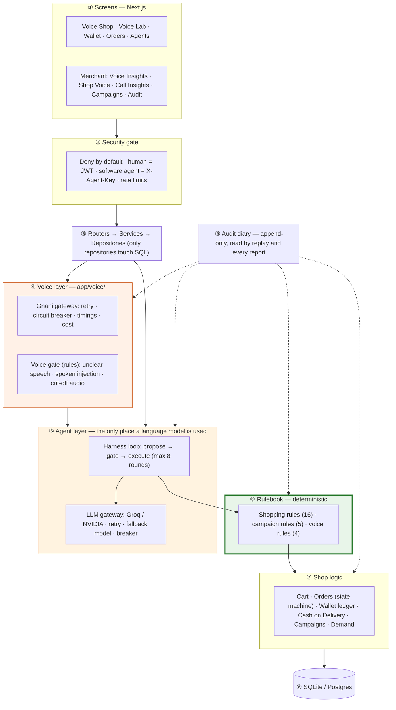

# Gnani Shop — Architecture

How Gnani Shop is put together, in plain words. Written for anyone who wants to
understand the system without reading the code first.

---

## The one idea

> **Gnani hears and speaks. The AI suggests. The rulebook decides. The diary remembers.
> Only a human tap moves money.**

| Part | Plain name | What it is |
|---|---|---|
| 👂 + 👄 | **Ear and mouth** | Gnani Vachana — Prisma v3.0 (speech → text) and Timbre v3.0 / v2.5 (text → speech) |
| 🧠 | **Brain** | An OpenAI-compatible LLM (Groq or NVIDIA NIM, `gpt-oss-120b`) that turns words into *suggested* actions |
| 📕 | **Rulebook** | Plain Python policy rules. No AI. Every suggestion is checked here: **allow · ask the human · refuse** |
| ✋ | **Hands** | Cart, orders, wallet, Cash on Delivery — they act only on what the rulebook allowed |
| 📓 | **Diary** | The append-only audit log. Nothing in the code can edit or delete it |

The AI never executes anything. If it is confused, tricked (by text *or* by voice), or
replaced by a different model tomorrow, the limits on your money do not change —
they were never written in a prompt.

---

## Layers



Green is deterministic. Orange is the only place a language model is involved.
Nothing green ever reads model output as an instruction.

---

## One voice turn, end to end

```mermaid
sequenceDiagram
    participant B as Buyer (browser mic)
    participant V as Voice layer
    participant G as Gnani Vachana
    participant H as Agent harness
    participant L as LLM (Groq/NVIDIA)
    participant P as Rulebook
    participant A as Audit diary

    B->>V: 16 kHz PCM (push-to-talk WAV or realtime WebSocket frames)
    V->>G: Prisma v3.0 · indic-auto · format=transcribe · keyterms from the catalog
    G-->>V: "నాకు రెండు ఆట్టా ప్యాకెట్లు…" + detected_language te-IN + timings
    V->>A: voice_transcribed
    V->>V: voice gate — unclear? cut off? an instruction to break the rules?
    V->>A: voice_gate_decision
    V->>H: transcript, language=te-IN, channel=voice
    H->>L: system prompt ("reply in Telugu, 1–3 short sentences") + history + tools
    L-->>H: proposed tool call: add_to_cart(GRO-001, 2)
    H->>P: evaluate with REAL price, stock, budget, agent limits
    P-->>H: ALLOW / REQUIRE_CONFIRMATION / DENY + reason
    H->>A: policy_decision (+ tool_executed if allowed)
    H-->>V: reply in Telugu
    V->>V: strip any audio tags the model wrote; add template tags (<excited>, <pauses>)
    V-->>B: reply text + speakable text
    B->>G: Timbre v3.0 SSE stream (via /api/voice/tts/stream) — plays from the first chunk
```

**What voice can never do:** approve a pending action or pay. The voice endpoints
only ever call `harness.handle_chat`. While a payment waits for confirmation, any
new message — spoken or typed — gets "please confirm first". Approving is
`POST /api/agent/confirm` (a tap), paying is `POST /api/payments/pay` (a tap).
A test (`test_voice_router_has_no_path_to_confirm_or_pay`) checks the voice code
never imports either.

---

## Payments: Mode A and Mode B

There is no card gateway. Two providers sit behind one `PaymentProvider` slot
(`app/payments/provider.py`), so a real gateway can be added later as one class:

| Provider | What happens | Money moves? |
|---|---|---|
| **Gnani Shop Wallet** | Debits an append-only ledger. Balance = sum of entries. A debit is keyed by order id under a UNIQUE constraint, so the same order can never be charged twice | Yes (demo money) |
| **Cash on Delivery** | Order becomes `CONFIRMED_COD`; the merchant marks cash collected later (`→ PAID`) | No, not until delivery |

| | **Mode A — tap to pay** (default) | **Mode B — agent autopay** (optional) |
|---|---|---|
| Who pays | A human, signed in, with a tap | The agent, from the owner's wallet |
| Switched on by | Always on | Only the owner, per agent (`POST /api/agents/{id}/autopay`, BUYER-only) |
| Limit | Session budget | A separate autopay limit, checked by `AgentAutopayRule` |
| Methods | Wallet or COD | Wallet only — an agent can't promise cash at the door |
| Recorded as | `authorized_by = human_tap` | `authorized_by = agent_autopay` |

An agent key may **decline** its own pending action but never **approve** one
(`/api/agent/confirm` returns 403 for `approve=true` from an agent). The owner sees
pending requests in *My Agent → Waiting for your approval*.

### Order state machine

```
PENDING → AWAITING_PAYMENT → PAID                 (wallet)
                           → CONFIRMED_COD → PAID (cash collected)
                           → FAILED → (retry) → PAID / CONFIRMED_COD
any non-terminal → CANCELLED          PAID is terminal: never downgraded
```

---

## The rulebook

**Shopping rules** (`app/policy/rules.py`), checked in this order — refuse beats ask beats allow:

| Rule | Plain meaning |
|---|---|
| RevokedCredentialRule · AgentScopeRule | A revoked agent can't act; an agent can only use tools it was given |
| InjectionTaintRule | A product whose own text contains hidden instructions can't be bought |
| UnknownSkuRule | The AI invented a product → refused |
| OutOfStockRule · StockRule | Can't buy what isn't there |
| PerItemPriceRule · QuantityRule | No single item over ₹3,000; at most 10 of one item |
| SpendCapRule | Never over the session budget (default ₹5,000) |
| AgentSpendLimitRule | Never over this agent's own limit |
| **AccountSpendLimitRule** *(new)* | All of an owner's agents together stay under one account cap |
| UpsellPolicyRule | At most one extra offer per conversation, never more than half the cart |
| ConfirmationThresholdRule | Carts over ₹1,000 need a tap |
| DuplicatePaymentRule | A cart already paid or placed as COD can't be paid again |
| **AgentAutopayRule** *(new)* | Mode A/B: an agent's payment needs the owner unless autopay is on and within its limit |
| PaymentAuthorizationRule | Re-checks the whole cart at payment time. **Never returns ALLOW** |

**Campaign rules** (`app/campaigns/rules.py`): minimum segment size, 30% max discount,
15% minimum margin, campaign budget, one offer per customer per 30 days.

**Voice gate** (`app/voice/policy.py`): VoiceConfidenceRule (empty / too short / filler
noise → "please repeat"), TruncatedAudioRule, SpokenInjectionRule (10 languages +
Hinglish), SupportedLanguageRule (unknown language → reply in English).

**AudioTagControl** (`app/voice/spoken.py`): tags the model writes are removed and
logged; only fixed templates add `<excited>` / `<pauses>`, and only for Timbre v3.0.

---

## Languages

- **Hearing**: Prisma v3.0 with `indic-auto` — no language picker; the detected
  language is stored on the conversation and the agent is told to reply in it.
- **Speaking**: always an explicit language code to Timbre (under `auto`, Marathi
  Devanagari would be read as Hindi).
- **Finding products in any language**: `app/i18n/grocery_terms.py` maps "ఆట్టా",
  "आटा", "aata"… to the catalog tag `atta`. A dictionary lookup, not AI. The same
  vocabulary gives each product its local names and Prisma's keyterms.
- **Key spoken moments** (confirm the amount, order placed, didn't catch that, voice
  unavailable…) are fixed phrases in all 10 languages, so the read-back of an amount
  never depends on the model.
- **Demand alerts** normalise every request to an English category, so "आटा" and
  "atta" count as the same unmet need.

---

## Resilience

| Failure | What happens |
|---|---|
| Gnani slow / 5xx / 429 | Retry with backoff → circuit breaker opens after 3 failures → voice says "please type" in the buyer's language; the shop keeps working |
| LLM rate-limited | Waits as long as the provider says ("try again in 2.6s", capped) → fallback model → breaker |
| AI invents a product / sends broken JSON | Rulebook refuses / harness rejects, the AI is told why |
| Wallet short | Payment FAILED (nothing charged) → retry, top up, or Cash on Delivery |
| Double tap | One debit, by database constraint |

All of these can be triggered on purpose in development with an `X-Chaos-Fault`
header: `SLOW_LLM`, `LLM_MALFORMED_TOOL_CALL`, `HALLUCINATE_SKU`, `DB_CONFLICT`,
`FAIL_PAYMENT`, `PAYMENT_PROVIDER_TIMEOUT`, `GNANI_STT_TIMEOUT`, `GNANI_TTS_FAILURE`,
`GNANI_GARBLED_TRANSCRIPT`. Chaos (and demo login) exist only when
`APP_ENV=development` — checked in code, not by a flag.

---

## Data and privacy

- **Raw audio is never stored** — only the transcript the agent acted on.
- Voice cloning stores only Gnani's embedding, with the merchant's consent text
  saved on the row and in the audit log.
- Demand signals have no buyer-identity column at all.
- The audit log's repository has no update or delete function.

---

## Scaling notes (honest limits)

- Single process. The rate limiter is in-memory — several workers would need Redis.
- SQLite by default; Postgres works (`DATABASE_URL`), and the wallet takes a row lock there.
- Voice turns take roughly 1–3 s for Gnani plus however long the LLM takes; on Groq's free
  tier (8,000 tokens/minute) a multi-step turn can wait several seconds for quota.
